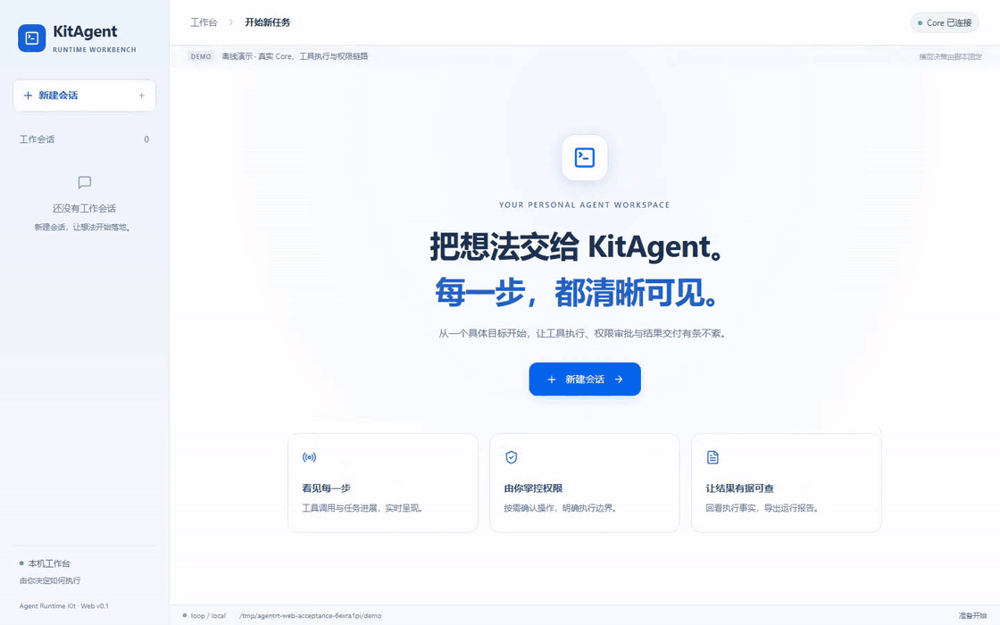
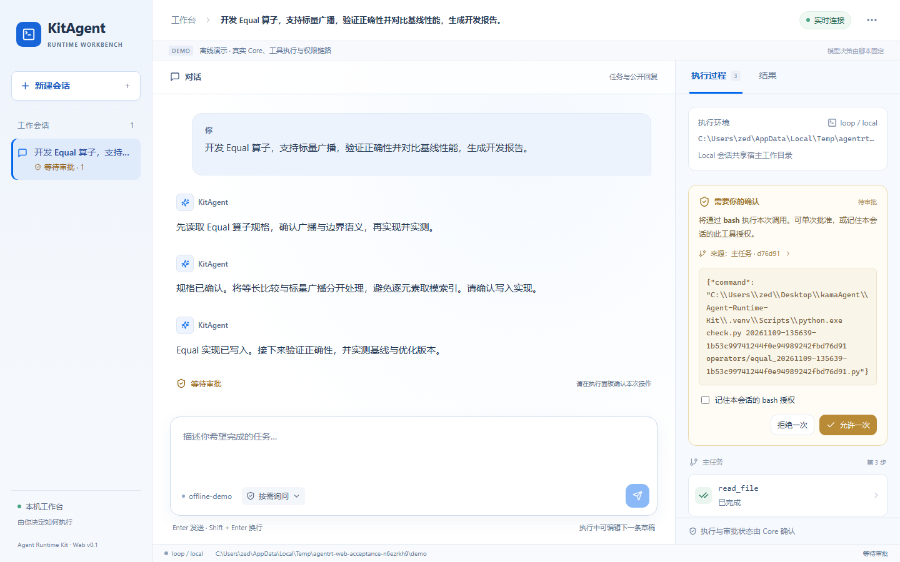

<div align="center">

<h1>KitAgent</h1>

<p><strong>Run your AI agent from the browser or terminal</strong></p>

<p>An open-source AI agent runtime and visual workbench</p>
<p><sub>Conversational tasks · Live tool tracking · Human approval · Session memory · Kubernetes sandboxes</sub></p>

<p>
  <a href="https://github.com/zed123214/kitagent/actions/workflows/ci.yml"></a>
  <a href="https://www.python.org/"></a>
  <a href="frontend/package.json"></a>
  <a href="docs/kubernetes-sandbox.md"></a>
  <a href="LICENSE"></a>
</p>

[中文](README.md) · **English**

[Demo](#demo) · [Operator Workflow](#operator-demo) · [Features](#features) · [Architecture](#architecture) · [Quick Start](#quick-start) · [Documentation](#docs)

</div>

---

KitAgent is for developers who build and use AI automation tools. Describe a task in your browser or terminal, let the agent read your project, run commands, and edit files, then continue in the same conversation. Use the workbench to inspect tool calls, handle approvals, follow subtasks, and export a report for each run.

A persistent **Core** manages execution and sessions, with **Web / CLI / TUI** interfaces, **Loop / LangGraph** engines, and **Local / Kubernetes** tool environments.

<a id="demo"></a>

## 📸 Demo

**From a task description to results you can inspect and export.**



<p align="center">
  Sessions · Multi-turn chat · Tool timeline · Run reports<br />
  <a href="docs/assets/web-workbench-overview.png">Full-resolution screenshot</a> · <a href="https://raw.githubusercontent.com/zed123214/kitagent/main/docs/assets/web-workbench-demo.webm">Download the full video</a> · <a href="docs/web-workbench.md">Launch the workbench</a>
</p>

For a repository check, start with:

> Inspect the sample Python repository, run its check script, and write a report.

| Step | What you see in the workbench |
| --- | --- |
| **① Describe the goal** | Create a session and submit a task in natural language. |
| **② Follow execution** | Read agent responses, tool arguments, execution status, and output. |
| **③ Make decisions** | Approve or reject calls, and remember tool grants for the session. |
| **④ Use the result** | Review the conclusion, tools, and approvals; export the report and continue chatting. |

<details>
<summary><strong>See tool calls and human approval</strong></summary>



Choose Read-only, Ask as needed, or Auto-approve for a session. View and revoke remembered tool grants from the permission menu.

</details>

<p align="center"><sub>Built-in offline demo · Scripted model responses + live tool execution · <a href="docs/web-workbench.md#无-api-key-的真实工具演示">Try it locally</a></sub></p>

<a id="operator-demo"></a>

### 🧪 Workflow demo: Equal development and SparseFlashAttentionGrad optimization

Two Ascend C operators illustrate an iterative engineering workflow: **read the specification → establish correctness → locate bottlenecks → change and validate → preserve delivery evidence**. Equal covers operator development; SparseFlashAttentionGrad covers performance optimization of a gradient kernel.

These walkthroughs use existing project documentation and experiment archives. The prompts can be used in KitAgent; the historical results were not rerun by KitAgent for this README. The GIF above remains the repository-check demo.

| Stage | Equal: build and deliver an operator | SparseFlashAttentionGrad: optimize a gradient kernel |
| --- | --- | --- |
| **① Define the task** | Specify elementwise equality, BOOL output, broadcasting up to 8 dimensions, NaN, signed zero, and INT64 boundaries. | Identify sparse-index multiplicities, dQ / dK / dV, RoPE, and optional Value branches. |
| **② Establish a baseline** | Connect OpDef, InferShape, Host Tiling, the Ascend C kernel, and the two-stage ACLNN API; compare with a CPU reference. | Freeze source, inputs, and reference gradients; check correctness before measuring stages and cross-core waits. |
| **③ Implement a hypothesis** | Compress broadcast axes, precompute strides, compare contiguous segments, tile across cores, reuse UB buffers, and compare INT64 through exact high/low 32-bit components. | Batch repeated-index counts where eligible; move readiness aggregation to AIV and rebalance five query-row slabs and dK / dV reductions. |
| **④ Decide from measurements** | Run custom and builtin separately, verify loaded libraries, and compare correctness and device time against acceptance thresholds. | Keep slower candidates in the record, revise task ownership, and compare both execution orders. |
| **⑤ Deliver evidence** | Bind source versions, test matrices, CSVs, and acceptance notes. | Archive the official submission, historical prototypes, and readable refactor separately, with their validation scope. |

<details>
<summary><strong>Demo 1 · Equal: implementation, broadcasting, and acceptance</strong></summary>

Submit these prompts as successive turns, reviewing the evidence before continuing:

> **Turn 1 — Understand and plan.** Read the Equal specification, source, and tests in the workspace. Identify the input/output contract, dtypes, broadcasting rules, edge cases, and responsibilities of Host Tiling, the kernel, and ACLNN. Propose an implementation and validation sequence.

> **Turn 2 — Implement and optimize.** Use the correct current version as a baseline. Inspect broadcast indexing and data movement, select one supported optimization, and state its expected benefit and fallback conditions. After editing, check equal shapes, multidimensional broadcasting, tails, and special values. Preserve both versions.

> **Turn 3 — Validate and deliver.** Verify custom and builtin library paths. Compare correctness and device time on identical inputs. Report the source version, environment, sampling method, per-case results, and failures. Without an NPU, prepare reproduction commands and mark device checks as pending.

**Historical delivery:** records for source commit `763a5cf5` report **306/306 correctness passes** and **306/306 performance-threshold passes**. Project documentation records the merge through [cann/ops-math PR #5425](https://gitcode.com/cann/ops-math/pull/5425/discuss).

Timing used 5 warm-ups and the median of 10 device-task measurements. For builtin time B and custom time C, acceptance requires C ≤ B + 3 μs when B < 15 μs, otherwise B/C ≥ 0.95. Of the stress cases, 131 reused traceable historical builtin baselines; 4 used two paired reruns of both implementations. Passing does not mean every case is faster or that both A2 and A3 hardware independently ran the entire suite.

</details>

<details>
<summary><strong>Demo 2 · SparseFlashAttentionGrad: profiling, rejected candidates, and paired validation</strong></summary>

> **Turn 1 — Find the bottleneck.** Read the baseline, index-counting implementation, and profiling records. Check that repeated indices retain their multiplicity. Distinguish computation, transfers, and readiness waits, citing evidence for each diagnosis.

> **Turn 2 — Iterate.** Explain why the initial five-slab candidate regressed, including dK / dV work on short-slab cores. Revise the mapping while preserving output ownership and complete reductions. Validate all three gradients, then compare against the matching baseline in both execution orders. Keep failed results.

> **Turn 3 — Archive.** Separate the official submission, historical prototype, and readable refactor. Bind source hashes, vendor, input hashes, and reports. Summarize correctness, performance, and untested scope, then export the workbench run report.

**One recorded optimization cycle:**

| Decision | Observation | Next step |
| --- | --- | --- |
| Reject the initial five-slab prototype | Time increased **4.76% / 1.47%** in the two orders; stage records placed the dK / dV tail on short-slab cores. | Redistribute reduction work and retain the regression record. |
| Promote the revised historical prototype | On 910B3: **280.17 → 258.99 μs** forward, **275.31 → 259.71 μs** reverse, reducing time by **7.56% / 5.67%**. | Evaluate against its own contiguous-C1 control before integration. Evidence covers these two orders and combined changes, with no final single-mechanism ablation. |
| Validate the post-competition R5 refactor | On 910B4 / CANN 8.5.0: **56 FP16 correctness reports and 112 poison checks** across 28 scenarios and two versions; 180 Event reports across 15 geometries yielded a geometric mean candidate/original median-time ratio of **0.99555**. | Passed the predefined no-material-regression thresholds; BF16 coverage was template compilation only. |

Official submission `1041451` is **Pass / 47.21 points** in the archived **October 31, 2026** ranking. Prototype gains, official scores, and R5 regression results use separate measurement scopes.

</details>

**Try the workflow in KitAgent:** follow [Quick Start](#quick-start), make the source and test materials accessible to tools, and submit the prompts using a live model. Inspect file reads, edits, builds, and test output in the tool timeline, handle session approvals, and export the report. Device validation requires a compatible Ascend NPU, driver, CANN, and test tools; the default Local / kind environment does not supply that hardware.

<details>
<summary><strong>Sources and scope</strong></summary>

Sources: `Equal算子开发流程与面试讲解.md` (September 16, 2026, chapters 3, 11, and 12), and the technical notes, optimization history, and experiment records in `星辰杯_答辩材料包_2026-11-06`. SparseFlashAttentionGrad figures map to E01 ranking, E02 correctness status, E03 paired comparison, E11 prototype decision, and the initial five-slab record. These original materials are not distributed with KitAgent.

The archives disclose AI assistance with code research, edits, experiment orchestration, and evidence organization. They do not provide an end-to-end KitAgent run record or a human-hours comparison, so no Agent productivity gain is claimed.

</details>

<a id="features"></a>

## ✨ Features

### One Core, three interfaces

Chat, approve calls, and inspect reports in the **Web workbench**. Submit tasks and integrate scripts through the **CLI**, or work in the terminal with the **Textual TUI**. All three interfaces share the runtime protocol, with Core managing task and session state.

The Web gateway maintains its Core connection, so you can refresh the browser and keep following an active task.

### Execution you can inspect

Follow streaming responses and a tool timeline to see which tools ran, their inputs, outputs, and timing. Each run records events in `events.jsonl` for replay; correlation IDs connect parent and child tasks.

Export a run report with the conclusion, tool output, and approval records for review or sharing.

### Collaboration and tool approval

Add requirements and adjust direction through multi-turn conversation. Use approval cards to decide whether a tool should run, remember a tool grant for the session, or revoke it from the permission menu.

Built-in tools and MCP tools share registration, argument validation, permission policies, and execution records.

### Session memory and extensions

Keep conversation history, long-term notes, and compact summaries across turns. Package workflows as Markdown **Skills**, connect external tools through **MCP**, and delegate independent work to **Subagents** with their own contexts.

### Engine choice and durable recovery

Use the default **Loop** engine for model–tool execution or **LangGraph** for explicit node orchestration. With **Graph + SQLite + Local**, save checkpoints and approval interrupts, resume after a Core restart, and reuse recorded tool results.

### Kubernetes workspaces per session

Use **Local** tools for development, or enable **Kubernetes Sandbox** to create a Pod on demand for each session. Turns and subagents within a session share the workspace, with resource limits, network policies, idle reclamation, and cleanup on close.

<a id="architecture"></a>

## 🏗️ Architecture


<p align="center">
  <a href="docs/assets/architecture.en.png">High-resolution PNG</a> · <a href="docs/assets/architecture.drawio">Editable draw.io source</a> · <a href="docs/architecture.md">Architecture details</a>
</p>

**Follow a task:** submit a goal → Core creates a run → engine calls the model → approve and execute tools → stream events → commit the session result.

| Layer | Technology and responsibility |
| --- | --- |
| **Interfaces** | React 19, TypeScript, assistant-ui, Textual; Web, CLI, and TUI. |
| **Transport** | FastAPI and WebSocket; the gateway connects to Core through JSON-RPC 2.0 / NDJSON TCP. |
| **Runtime** | Python 3.12, asyncio, Pydantic v2; sessions, tasks, permissions, and events. |
| **Engines** | Loop / LangGraph; shared model, tool, and session interfaces. |
| **Model integration** | Anthropic Provider; server-side model and API key configuration. |
| **Tool environments** | Local / Kubernetes; command execution and file operations. |
| **Storage and extensions** | JSONL, Markdown, SQLite; replay, memory, recovery, Skills, and MCP. |

## 📊 Measured Results

Sandbox validation completed on **September 9, 2026**, using **single-node kind / Kubernetes v1.36.4 / Cilium 1.20.1**, an offline provider, and preloaded images.

| Check | Result |
| --- | --- |
| **Live-cluster validation** | M1 **13/13**, M2 **442/442**, across 12 experiment categories. |
| **Concurrent session isolation** | **20** sessions, **200** cross-session read/write probes, **0** leaks. |
| **Creation and cleanup** | **100/100** completed, **0** resources left at the end. |
| **Sandbox cold start** | **3.52 s** p95 to Ready, 30 serial samples. |
| **Execution overhead after Ready** | **19.26 ms** p95, 100 samples; Core duration minus Worker command duration. |

[Sandbox configuration and validation walkthrough →](docs/kubernetes-sandbox.md#构建渲染与后续验收)

<a id="quick-start"></a>

## 🚀 Quick Start

Run these commands in **Bash on Linux / WSL2**. Install **Python 3.12** and [uv](https://docs.astral.sh/uv/). The Web workbench also needs **Node.js 22.12+** to build its frontend.

### 1. Install and configure the model

```bash
git clone https://github.com/zed123214/kitagent.git
cd kitagent
uv sync --frozen --extra web
cp .env.example .env
```

Edit `.env` with your model configuration:

```dotenv
ANTHROPIC_API_KEY=your-api-key
AGENTRT_LLM_DEFAULT_MODEL=claude-sonnet-4-6
```

### 2. Build the workbench

```bash
cd frontend
npm ci
npm run build
cd ..
```

### 3. Start Core and the Web gateway

Open two terminals in the repository root.

**Terminal one · Core**

```bash
uv run --frozen --extra web agentrt-core
```

**Terminal two · Web gateway**

```bash
uv run --frozen --extra web agentrt-web
```

Open the gateway's startup link (`http://localhost:8765/#bootstrap=…`), create a session, and submit your first task. The default is **Loop + Local**, with tools running in Core's working directory.

### Prefer the terminal?

With Core running, use the CLI or TUI in another terminal:

```bash
# Check the connection
uv run --frozen --extra web agentrt ping

# Submit a task
uv run --frozen --extra web agentrt run --goal "Read the project structure and summarize the main modules"

# Open the terminal interface
uv run --frozen --extra web agentrt-tui
```

<details>
<summary><strong>No API key needed: try the engine and cross-process recovery</strong></summary>

Run the offline model → tool → model example:

```bash
uv run --frozen --extra graph python examples/graph_offline_demo.py
```

Resume a task after a Core restart and reuse completed tool results:

```bash
uv run --frozen --extra graph-sqlite python examples/durable_recovery_demo.py
```

For an offline browser demo, see the [workbench guide](docs/web-workbench.md#无-api-key-的真实工具演示).

</details>

### Choose a runtime mode

| Mode | Use case | Guide |
| --- | --- | --- |
| **Loop + Local** | Web workbench, local development, and everyday tasks | [Workbench](docs/web-workbench.md) · [Runbook](RUNBOOK.md) |
| **Graph + Memory** | Explicit node orchestration and in-process session continuation | [Graph engine](docs/graph-engine.md) |
| **Graph + SQLite + Local** | Core restart recovery and durable human approval | [Recovery](docs/durable-recovery.md) |
| **Loop / Graph Memory + Kubernetes** | Container workspaces per session | [Sandbox deployment](docs/kubernetes-sandbox.md) |

<a id="docs"></a>

## 📚 Documentation

| I want to… | Start here |
| --- | --- |
| Use the browser workbench | [Web workbench](docs/web-workbench.md) |
| Configure and run the project | [Runbook](RUNBOOK.md) |
| Follow task execution | [Architecture](docs/architecture.md) · [Agent Loop](docs/agent-loop.md) |
| Use Graph and recovery | [Graph engine](docs/graph-engine.md) · [Durable recovery](docs/durable-recovery.md) |
| Deploy Kubernetes sandboxes | [Deployment and validation](docs/kubernetes-sandbox.md) |
| Configure permissions and memory | [Tool permissions](docs/tool-permissions.md) · [Session memory](docs/session-memory.md) |
| Extend workflows and tools | [Skills / Subagents / MCP](docs/skills-subagents-mcp.md) |
| Build a client or contribute | [Wire protocol](WIRE_PROTOCOL.md) · [Contributing](CONTRIBUTING.md) |

## 🤝 Contributing

Share use cases, report bugs through [Issues](https://github.com/zed123214/kitagent/issues), or open a pull request. See [CONTRIBUTING.md](CONTRIBUTING.md) for development setup and checks.

If KitAgent helps with your work, give it a **Star** and share what you built with it.

## 📄 License

[MIT](LICENSE)
