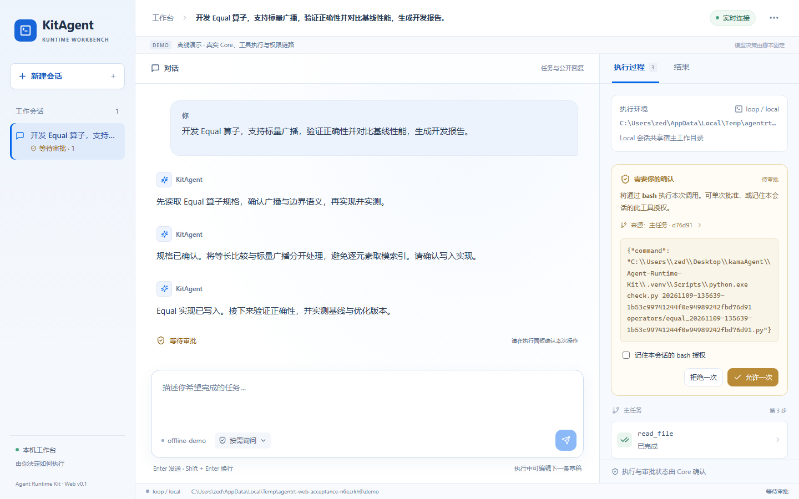

<div align="center">

<h1>KitAgent</h1>

<p><strong>让 AI Agent 参与代码开发、测试与性能优化</strong></p>

<p>开源 AI Agent 运行时与可视化工作台</p>
<p><sub>对话驱动任务 · 实时工具追踪 · 人工审批 · 会话记忆 · Kubernetes 沙箱</sub></p>

<p>
  <a href="https://github.com/zed123214/kitagent/actions/workflows/ci.yml"></a>
  <a href="https://www.python.org/"></a>
  <a href="frontend/package.json"></a>
  <a href="docs/kubernetes-sandbox.md"></a>
  <a href="LICENSE"></a>
</p>

**中文** · [English](README.en.md)

[产品演示](#demo) · [算子优化实战](#operator-demo) · [核心能力](#features) · [系统架构](#architecture) · [快速开始](#quick-start) · [文档导航](#docs)

<p><a href="https://github.com/zed123214/kitagent"><strong>⭐ Star KitAgent</strong></a> · <a href="#quick-start">开始使用</a> · <a href="#operator-demo">学习算子优化</a></p>

</div>

---

KitAgent 是开源 AI Agent 运行时与可视化工作台。你描述开发目标，Agent 阅读代码、修改文件、执行命令；你在浏览器中查看工具输出、处理审批，并在同一会话里继续推进任务。

从仓库检查到算子性能优化，你可以把分析、实验和交付串成一套工作流程。下面用 **Equal** 与 **SparseFlashAttentionGrad**，讲清如何定位瓶颈、组织数据和分配计算任务。

项目以常驻 **Core** 管理执行与会话，提供 **Web / CLI / TUI** 三种交互入口，支持 **Loop / LangGraph** 执行引擎，以及 **Local / Kubernetes** 工具环境。

<a id="demo"></a>

## 📸 产品演示

**从算子规格，到实现、正确性验证与性能实测。**


<p align="center">
  Equal 算子开发 · 广播与边界验证 · 基线性能对比 · 开发报告<br />
  <a href="docs/assets/web-workbench-overview.png">查看高清截图</a> · <a href="https://raw.githubusercontent.com/zed123214/kitagent/main/docs/assets/web-workbench-demo.webm">下载完整视频</a> · <a href="docs/web-workbench.md">启动工作台</a>
</p>

以 `Equal` 算子开发为例：

> 开发 Equal 算子，支持标量广播，验证正确性并对比基线性能，生成开发报告。

| 步骤 | 你在工作台中看到的内容 |
| --- | --- |
| **① 确认规格** | 读取 Equal 规格，明确等长比较、标量广播与边界语义。 |
| **② 编写实现** | 审批写入算子实现，将等长与广播路径分开，移除逐元素取模索引。 |
| **③ 验证与实测** | 审批运行测试，验证 75 个用例；对三组输入预热 3 次、采样 9 次，对比中位耗时。 |
| **④ 交付报告** | 审批保存开发报告，读回核对结果；导出结论、工具证据和审批记录。 |

<details>
<summary><strong>展开查看：工具调用与人工审批</strong></summary>



工作台提供「只读 / 按需询问 / 自动批准」三种会话权限模式，并支持查看和撤销已记住的工具授权。

</details>

<p align="center"><sub>内置离线演示 · 脚本化模型响应 + 实际工具执行 · <a href="docs/web-workbench.md#无-api-key-的真实工具演示">在本机体验</a></sub></p>

<a id="operator-demo"></a>

## 🧪 用 Agent 做算子优化：从 Equal 到 SparseFlashAttentionGrad

算子把数学运算变成硬件上的数据搬运与计算。以 `Equal` 为例，比较两个数只需一步，但处理整块 Tensor 时，还要安排广播索引、分块搬运和多核执行。性能优化就从这些安排入手。

这里用两个案例带你走完开发过程：从 Equal 学会广播、分块与复用，再用 SparseFlashAttentionGrad 理解矩阵核与向量核协作、流水排程和负载均衡。你可以在 KitAgent 中逐轮分析、修改、执行测试，并查看每一步的工具输出。

### Equal：一次比较背后的数据安排

`Equal` 对两个 Tensor 逐元素比较，输出 BOOL。输入 `[2,1]` 和 `[1,3]` 时，输出是 `[2,3]`：一边沿列重复，另一边沿行重复。实现时可以通过地址映射读取原输入，让每一块输出找到对应的数据。

**第一步，把重复的索引工作提前算好。** Host 合并广播模式相同的相邻维度，预计算每一维的 stride。Kernel 每次定位一段连续数据，随后成批比较，减少内层循环的坐标计算。

**第二步，让搬进来的数据多用几次。** 按输入类型和 UB（片上缓冲区）容量确定 tile 大小，将输入、输出和计算暂存一起纳入预算。标量缓存、广播面缓存和尾行复用减少重复读取；多核切分让各核处理自己的输出区间。

**第三步，把数值语义放进测试。** 浮点比较覆盖 NaN、正负零和无穷大；INT64 将高低 32 位分别比较，再合成结果，保留完整整数信息。通过 ACLNN 接口，把参数校验、计算和输出交付串起来。

| 开发环节 | 学到的方法 | 交付结果 |
| --- | --- | --- |
| 规格与基线 | 用广播示例和特殊值定义正确行为。 | 输入输出契约、CPU golden、测试矩阵。 |
| Tiling 与 Kernel | 在 Host 预处理索引，在设备上按块比较和复用数据。 | 广播轴压缩、多核分块、向量比较、缓存复用。 |
| 验收与合入 | 固定版本，对照结果，汇总逐项测试。 | **306/306 精度通过**，代码通过 [cann/ops-math PR #5425](https://gitcode.com/cann/ops-math/pull/5425/discuss) 合入。 |

### SparseFlashAttentionGrad：把工作分对，减少整条流水的等待

稀疏 Attention 反向计算需要生成 `dQ / dK / dV` 三路梯度，同时处理索引、系数和梯度累加。优化时要一起考虑每块数据何时就绪、交给哪个核、结果在哪里汇总。

**先优化频数统计。** 稀疏索引 `[2,0,2,3]` 对应 key `[0,1,2,3]` 的频数是 `[1,0,2,1]`。重复 key 的贡献按次数进入梯度。将索引排序后，用累计计数边界的差批量生成频数，可以改变逐条读写计数槽的处理方式。

**再拆开计算与协调。** AIC（矩阵核）执行矩阵乘，AIV（向量核）处理频数和系数，并汇总就绪信号。用时间线把生产系数、发布信号、等待和梯度计算连起来，就能找到谁在阻塞下一轮。

**最后按完整任务分核。** 将 512 行切成 `128 / 128 / 128 / 64 / 64` 后，还要把各核后续的 dK / dV 归约计算进去。短块核承担的查询行少，却可能因为额外归约工作拖长收尾；把部分归约重新分给长块核，就能改善整组任务的完成时间。

下面这轮 910B3 五分片样机实验，展示了如何用测量推动下一次修改：

| 迭代 | 观察 | 方法 |
| --- | --- | --- |
| 初次分片 | 两种测量顺序下，耗时分别增加 **4.76% / 1.47%**；dK / dV 尾部集中在短块核。 | 同时统计查询行和梯度归约的负担。 |
| 调整任务归属 | 正序 **280.17 → 258.99 μs**；反序 **275.31 → 259.71 μs**。 | 重新分配归约，耗时分别下降 **7.56% / 5.67%**。 |
| 集成回归 | R5 在 910B4 / CANN 8.5.0 下完成 **56 份 FP16 精度报告、112 次毒值检查**。 | 对完整梯度、输出写入和输入不变性一起验证。 |

这一轮的关键是：测出尾部集中在哪里，将查询与归约合起来分配，再用相同条件对照验证。下一次优化继续从新的时间线开始。

### 从案例中提炼四步优化方法

| 步骤 | 要解决的问题 | 具体做法 |
| --- | --- | --- |
| **① 测量耗时** | 时间花在计算、搬运还是等待？ | 跑通基线，用 profiling 和时间线找到决定完成时间的阶段。 |
| **② 减少搬运** | 同一份数据读写了多少次？ | 融合相邻计算，把数据切成能放进片上存储的小块，让中间结果和重复输入就地复用。 |
| **③ 安排并行** | 哪些核在忙，哪些核在等？ | 让矩阵核做矩阵乘、向量核处理系数；交叠搬运与计算，按实际工作量分配任务。 |
| **④ 对照验证** | 这项改动带来了什么变化？ | 对齐输入和环境，检查参考输出，重复测量基线与候选，记录差异并选择下一项优化。 |

延伸阅读：小林coding 的[《杀进决赛！这 28 支队伍把算子优化卷疯了！》](https://mp.weixin.qq.com/s/Sr8wVJQw0Pt6xZSOtdHp2w)从数据搬运、分块复用和任务分配讲解算子优化。

### 把这套方法交给 KitAgent

在工作台中提供源码、任务说明、参考实现和测试命令，用同一会话推进分析、修改和验证。你可以随时补充要求，在工具时间线查看执行过程，从审批卡决定工具调用，最后导出运行报告。

| 轮次 | 交给 Agent 的任务 | 你检查的产物 |
| --- | --- | --- |
| **读懂任务** | 解释输入输出，画清数据依赖，整理构建和测试入口。 | 计算步骤、验证命令、正确性基线。 |
| **找到瓶颈** | 分析 profiling，比较算法、搬运和任务分配方案。 | 耗时分布、优化假设、候选改动。 |
| **跑一轮实验** | 修改候选，执行精度测试与配对测速。 | 代码差异、逐项结果、前后耗时。 |
| **继续迭代** | 根据结果保留或调整方案，完成集成回归。 | 可交付版本、实验结论、运行报告。 |

<details>
<summary><strong>复制这段任务，开始你的第一轮优化</strong></summary>

```text
请协助优化工作区中的算子。

先阅读任务说明、源码与参考实现，整理输入输出、数据依赖、
构建命令和测试入口，建立正确性与性能基线。

分析时间花在计算、数据搬运、索引处理还是核间等待。
选择一项优化，解释它如何减少开销，保存基线并实现候选。

使用相同输入检查输出，按基线→候选、候选→基线的顺序
重复测速。汇总代码改动、精度结果与耗时变化，
据此决定下一轮实验，最后生成可复盘的优化报告。
```

处理更大的任务时，可用 [Subagents](docs/skills-subagents-mcp.md) 分别研究算法、流水线和测试，由主任务汇总方案、安排设备测量并完成集成。将成熟步骤整理为 Skills，下一次开发继续复用。

</details>

**准备好试一轮了？** [启动工作台](#quick-start)，把你的任务交给 Agent。觉得这套开发方式有用，欢迎点一个 [**⭐ Star**](https://github.com/zed123214/kitagent)，关注 KitAgent 的后续更新。

<a id="features"></a>

## ✨ 核心能力

### 一个 Core，三种交互方式

在 **Web 工作台**中对话、审批和查看报告，在 **CLI** 中提交任务与接入脚本，在 **Textual TUI** 中进行终端交互。三种入口共用运行时协议，任务执行和会话状态由 Core 管理。

Web 网关持续连接 Core，刷新浏览器后可以继续观察正在执行的任务。

### 看得见的执行过程

通过流式回复和工具时间线查看任务进展：调用了什么工具、输入是什么、结果如何、用了多久。每次运行的事件保存到 `events.jsonl`，支持历史回放；父任务与子任务通过关联标识串联。

运行报告汇集本轮结论、工具输出和审批记录，方便复盘与分享。

### 多轮协作与工具审批

通过多轮对话补充要求、调整任务方向；通过审批卡片决定工具是否执行。你可以为当前会话记住某个工具的授权，也可以从权限菜单中撤销。

工具注册、参数校验、权限策略和执行记录采用同一套机制，内置工具与 MCP 工具都能接入。

### 会话记忆与能力扩展

会话历史、长期笔记和压缩摘要分层保存，让 Agent 在后续轮次中沿用已有信息。使用 Markdown **Skills** 封装工作流程，通过 **MCP** 连接外部工具，将独立子任务交给拥有各自上下文的 **Subagents**。

### 执行引擎与持久化恢复

默认 **Loop** 引擎运行模型与工具循环；可选 **LangGraph** 引擎提供显式节点编排。启用 **Graph + SQLite + Local** 后，可保存执行检查点与审批中断，在 Core 重启后续接任务，并复用已经记录的工具结果。

### 按会话组织的 Kubernetes 沙箱

本地开发使用 **Local** 工具环境；需要独立工作区时，启用 **Kubernetes Sandbox**，为每个会话按需创建 Pod。同一会话中的多轮任务与子 Agent 共用工作区，支持资源限制、网络策略、空闲回收和关闭清理。

<a id="architecture"></a>

## 🏗️ 系统架构


<p align="center">
  <a href="docs/assets/architecture.png">高清 PNG</a> · <a href="docs/assets/architecture.drawio">可编辑 draw.io 源文件</a> · <a href="docs/architecture.md">架构设计详解</a>
</p>

**任务路径：** 提交目标 → Core 创建任务 → 执行引擎调用模型 → 工具审批与执行 → 事件推送 → 会话结果。

| 层次 | 技术与职责 |
| --- | --- |
| **交互层** | React 19、TypeScript、assistant-ui、Textual；提供 Web、CLI 与 TUI。 |
| **连接层** | FastAPI、WebSocket；网关通过 JSON-RPC 2.0 / NDJSON TCP 连接 Core。 |
| **运行时** | Python 3.12、asyncio、Pydantic v2；管理会话、任务、权限与事件。 |
| **执行引擎** | Loop / LangGraph；复用模型、工具和会话接口。 |
| **模型接入** | Anthropic Provider；通过服务端配置设置模型与 API Key。 |
| **工具环境** | Local / Kubernetes；承载命令执行与文件操作。 |
| **持久化与扩展** | JSONL、Markdown、SQLite；支持事件回放、记忆、恢复、Skills 与 MCP。 |

## 📊 工程实测

2026-09-09，在 **单节点 kind / Kubernetes v1.36.4 / Cilium 1.20.1** 环境完成沙箱验收，使用离线 Provider 与预加载镜像。

| 验证项 | 结果 |
| --- | --- |
| **真实集群验收** | M1 **13/13**，M2 **442/442**，覆盖 12 类实验。 |
| **并发会话隔离** | **20** 个 Session，**200** 次跨会话读写探测，泄漏 **0**。 |
| **创建与回收** | **100/100** 完成，最终资源残留 **0**。 |
| **沙箱冷启动** | 到 Ready 的 p95 为 **3.52 s**，30 个样本、串行采样。 |
| **就绪后执行开销** | p95 **19.26 ms**，100 个样本，按 Core 总耗时减 Worker 命令耗时计算。 |

[查看沙箱配置与验收复现入口 →](docs/kubernetes-sandbox.md#构建渲染与后续验收)

<a id="quick-start"></a>

## 🚀 快速开始

以下命令在 **Linux / WSL2 的 Bash** 中运行。准备 **Python 3.12**、[uv](https://docs.astral.sh/uv/)；Web 工作台还需要 **Node.js 22.12+** 构建前端。

### 1. 安装并配置模型

```bash
git clone https://github.com/zed123214/kitagent.git
cd kitagent
uv sync --frozen --extra web
cp .env.example .env
```

编辑 `.env`，填写模型服务配置：

```dotenv
ANTHROPIC_API_KEY=your-api-key
AGENTRT_LLM_DEFAULT_MODEL=claude-sonnet-4-6
```

### 2. 构建工作台

```bash
cd frontend
npm ci
npm run build
cd ..
```

### 3. 启动 Core 与 Web 网关

在项目根目录打开两个终端。

**终端一 · Core**

```bash
uv run --frozen --extra web agentrt-core
```

**终端二 · Web 网关**

```bash
uv run --frozen --extra web agentrt-web
```

打开网关输出的启动链接（`http://localhost:8765/#bootstrap=…`），新建会话，即可提交第一条任务。默认使用 **Loop + Local**，工具在 Core 的工作目录中执行。

### 也可以从终端开始

Core 启动后，在另一个终端使用 CLI 或 TUI：

```bash
# 检查连接
uv run --frozen --extra web agentrt ping

# 提交任务
uv run --frozen --extra web agentrt run --goal "阅读项目结构，整理主要模块及其职责"

# 打开终端交互界面
uv run --frozen --extra web agentrt-tui
```

<details>
<summary><strong>无需 API Key：体验执行引擎与跨进程恢复</strong></summary>

运行模型 → 工具 → 模型的离线示例：

```bash
uv run --frozen --extra graph python examples/graph_offline_demo.py
```

体验 Core 重启后续接任务、复用已完成的工具结果：

```bash
uv run --frozen --extra graph-sqlite python examples/durable_recovery_demo.py
```

浏览器离线演示见[工作台说明](docs/web-workbench.md#无-api-key-的真实工具演示)。

</details>

### 选择运行模式

| 模式 | 适用场景 | 使用指南 |
| --- | --- | --- |
| **Loop + Local** | 浏览器工作台、本地开发与日常任务 | [工作台](docs/web-workbench.md) · [运行手册](RUNBOOK.md) |
| **Graph + Memory** | 显式节点编排与进程内会话续接 | [Graph 引擎](docs/graph-engine.md) |
| **Graph + SQLite + Local** | Core 重启恢复与持久化人工审批 | [恢复配置](docs/durable-recovery.md) |
| **Loop / Graph Memory + Kubernetes** | 按会话分配的容器工作区 | [沙箱部署](docs/kubernetes-sandbox.md) |

<a id="docs"></a>

## 📚 文档导航

| 我想…… | 从这里开始 |
| --- | --- |
| 使用浏览器工作台 | [Web 工作台](docs/web-workbench.md) |
| 配置并运行项目 | [运行手册](RUNBOOK.md) |
| 理解任务执行链路 | [系统架构](docs/architecture.md) · [Agent Loop](docs/agent-loop.md) |
| 使用 Graph 与故障恢复 | [Graph 引擎](docs/graph-engine.md) · [持久化恢复](docs/durable-recovery.md) |
| 部署 Kubernetes 沙箱 | [部署指南与验收复现](docs/kubernetes-sandbox.md) |
| 配置权限和会话记忆 | [工具权限](docs/tool-permissions.md) · [会话记忆](docs/session-memory.md) |
| 扩展工作流程与工具 | [Skills / Subagents / MCP](docs/skills-subagents-mcp.md) |
| 开发客户端或参与贡献 | [通信协议](WIRE_PROTOCOL.md) · [贡献指南](CONTRIBUTING.md) |

## 🤝 参与贡献

欢迎通过 [Issues](https://github.com/zed123214/kitagent/issues) 分享使用场景、反馈问题，或提交 Pull Request。开发环境与检查命令见 [CONTRIBUTING.md](CONTRIBUTING.md)。

想用 AI Agent 推进自己的开发任务？欢迎点一个 [**⭐ Star**](https://github.com/zed123214/kitagent)，也欢迎在 Issues 分享你的实验和使用场景。

## 📄 License

[MIT](LICENSE)
