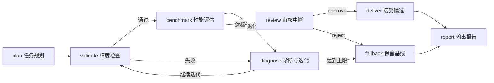

# 用 Agent 做算子优化：从 Equal 到 SparseFlashAttentionGrad

[返回项目首页](../README.md) · [启动工作台](../README.md#quick-start)

算子把数学运算变成硬件上的数据搬运与计算。以 `Equal` 为例，比较两个数只需一步，但处理整块 Tensor 时，还要安排广播索引、分块搬运和多核执行。性能优化就从这些安排入手。

这里用两个案例带你走完开发过程：从 Equal 学会广播、分块与复用，再用 SparseFlashAttentionGrad 理解矩阵核与向量核协作、流水排程和负载均衡。你可以在 KitAgent 中逐轮分析、修改、执行测试，并查看每一步的工具输出。

## Equal：一次比较背后的数据安排

`Equal` 对两个 Tensor 逐元素比较，输出 BOOL。输入 `[2,1]` 和 `[1,3]` 时，输出是 `[2,3]`：一边沿列重复，另一边沿行重复。实现时可以通过地址映射读取原输入，让每一块输出找到对应的数据。

**第一步，把重复的索引工作提前算好。** Host 合并广播模式相同的相邻维度，预计算每一维的 stride。Kernel 每次定位一段连续数据，随后成批比较，减少内层循环的坐标计算。

**第二步，让搬进来的数据多用几次。** 按输入类型和 UB（片上缓冲区）容量确定 tile 大小，将输入、输出和计算暂存一起纳入预算。标量缓存、广播面缓存和尾行复用减少重复读取；多核切分让各核处理自己的输出区间。

**第三步，把数值语义放进测试。** 浮点比较覆盖 NaN、正负零和无穷大；INT64 将高低 32 位分别比较，再合成结果，保留完整整数信息。通过 ACLNN 接口，把参数校验、计算和输出交付串起来。

| 开发环节 | 学到的方法 | 交付结果 |
| --- | --- | --- |
| 规格与基线 | 用广播示例和特殊值定义正确行为。 | 输入输出契约、CPU golden、测试矩阵。 |
| Tiling 与 Kernel | 在 Host 预处理索引，在设备上按块比较和复用数据。 | 广播轴压缩、多核分块、向量比较、缓存复用。 |
| 验收与合入 | 固定版本，对照结果，汇总逐项测试。 | **306/306 精度通过**，代码通过 [cann/ops-math PR #5425](https://gitcode.com/cann/ops-math/pull/5425/discuss) 合入。 |

## SparseFlashAttentionGrad：把工作分对，减少整条流水的等待

稀疏 Attention 反向计算需要生成 `dQ / dK / dV` 三路梯度，同时处理索引、系数和梯度累加。优化时要一起考虑每块数据何时就绪、交给哪个核、结果在哪里汇总。

**先优化频数统计。** 稀疏索引 `[2,0,2,3]` 对应 key `[0,1,2,3]` 的频数是 `[1,0,2,1]`。重复 key 的贡献按次数进入梯度。将索引排序后，用累计计数边界的差批量生成频数，可以改变逐条读写计数槽的处理方式。

**再拆开计算与协调。** AIC（矩阵核）执行矩阵乘，AIV（向量核）处理频数和系数，并汇总就绪信号。用时间线把生产系数、发布信号、等待和梯度计算连起来，就能找到谁在阻塞下一轮。

**最后按完整任务分核。** 将 512 行切成 `128 / 128 / 128 / 64 / 64` 后，还要把各核后续的 dK / dV 归约计算进去。短块核承担的查询行少，却可能因为额外归约工作拖长收尾；把部分归约重新分给长块核，就能改善整组任务的完成时间。

下面这轮 910B3 五分片样机实验，展示了如何用测量推动下一次修改：

| 迭代 | 观察 | 方法 |
| --- | --- | --- |
| 初次分片 | 两种测量顺序下，耗时分别增加 **4.76% / 1.47%**；dK / dV 尾部集中在短块核。 | 同时统计查询行和梯度归约的负担。 |
| 调整任务归属 | 正序 **280.17 → 258.99 μs**；反序 **275.31 → 259.71 μs**。 | 重新分配归约，耗时分别下降 **7.56% / 5.67%**。 |
| 集成回归 | R5 在 910B4 / CANN 8.5.0 下完成 **56 份 FP16 精度报告、112 次毒值检查**。 | 对完整梯度、输出写入和输入不变性一起验证。 |

这一轮的关键是：测出尾部集中在哪里，将查询与归约合起来分配，再用相同条件对照验证。下一次优化继续从新的时间线开始。

## 从案例中提炼四步优化方法

| 步骤 | 要解决的问题 | 具体做法 |
| --- | --- | --- |
| **① 测量耗时** | 时间花在计算、搬运还是等待？ | 跑通基线，用 profiling 和时间线找到决定完成时间的阶段。 |
| **② 减少搬运** | 同一份数据读写了多少次？ | 融合相邻计算，把数据切成能放进片上存储的小块，让中间结果和重复输入就地复用。 |
| **③ 安排并行** | 哪些核在忙，哪些核在等？ | 让矩阵核做矩阵乘、向量核处理系数；交叠搬运与计算，按实际工作量分配任务。 |
| **④ 对照验证** | 这项改动带来了什么变化？ | 对齐输入和环境，检查参考输出，重复测量基线与候选，记录差异并选择下一项优化。 |

延伸阅读：小林coding 的[《杀进决赛！这 28 支队伍把算子优化卷疯了！》](https://mp.weixin.qq.com/s/Sr8wVJQw0Pt6xZSOtdHp2w)从数据搬运、分块复用和任务分配讲解算子优化。

## 把这套方法交给 KitAgent

在工作台中提供源码、任务说明、参考实现和测试命令，用同一会话推进分析、修改和验证。你可以随时补充要求，在工具时间线查看执行过程，从审批卡决定工具调用，最后导出运行报告。

| 轮次 | 交给 Agent 的任务 | 你检查的产物 |
| --- | --- | --- |
| **读懂任务** | 解释输入输出，画清数据依赖，整理构建和测试入口。 | 计算步骤、验证命令、正确性基线。 |
| **找到瓶颈** | 分析 profiling，比较算法、搬运和任务分配方案。 | 耗时分布、优化假设、候选改动。 |
| **跑一轮实验** | 修改候选，执行精度测试与配对测速。 | 代码差异、逐项结果、前后耗时。 |
| **继续迭代** | 根据结果保留或调整方案，完成集成回归。 | 可交付版本、实验结论、运行报告。 |

<details>
<summary><strong>复制这段任务，开始你的第一轮优化</strong></summary>

```text
请协助优化工作区中的算子。

先阅读任务说明、源码与参考实现，整理输入输出、数据依赖、
构建命令和测试入口，建立正确性与性能基线。

分析时间花在计算、数据搬运、索引处理还是核间等待。
选择一项优化，解释它如何减少开销，保存基线并实现候选。

使用相同输入检查输出，按基线→候选、候选→基线的顺序
重复测速。汇总代码改动、精度结果与耗时变化，
据此决定下一轮实验，最后生成可复盘的优化报告。
```

处理更大的任务时，可用 [Subagents](skills-subagents-mcp.md) 分别研究算法、流水线和测试，由主任务汇总方案、安排设备测量并完成集成。将成熟步骤整理为 Skills，下一次开发继续复用。

</details>

<a id="operator-workflow"></a>

## LangGraph 实战：算子优化状态机

把一次算子优化组织成可追踪的工作流：**制定计划、验证候选、评估性能、诊断重试、审核交付**。每个节点更新共享状态，下一步由验证结果与审核决定驱动。



| LangGraph 场景 | 示例实现 | 你能看到什么 |
| --- | --- | --- |
| 有状态工作流 | `StateGraph` 保存阶段、候选序号、决策历史和选中版本 | 每轮结果随状态流转，失败记录持续保留 |
| 条件路由 | 精度与性能结果决定后继节点 | 精度失败跳过计时，性能退化进入诊断 |
| 迭代与终止 | `max_attempts` 控制候选轮次 | 预算耗尽后保留基线并生成报告 |
| 审核与恢复 | `interrupt()` 暂停，`Command(resume=...)` 传回决定 | 批准后交付，拒绝后保留基线 |
| 检查点 | `InMemorySaver` 按 `thread_id` 保存进程内状态 | 从审核节点续跑，已完成的评估保持原样 |
| 工具集成与观测 | KitAgent Graph 引擎调用工作流工具，业务图输出节点更新 | 同时观察 `model / kit_tools` 与业务阶段，导出 JSON 报告 |

**运行一次完整流程：**

```bash
uv run --frozen --extra graph python examples/operator_workflow_demo.py --review approve --output operator-report.json
```

切换 `--review reject` 查看审核拒绝分支；设置 `--max-attempts 1` 查看提前结束与基线保留。`--review` 指定本次演示在审核检查点恢复时使用的决定。

内置案例使用 SparseFlashAttentionGrad 的归档实验记录：五分片初稿退化后进入下一轮，重分配候选通过评估后进入审核。报告保留各候选的对照耗时、变化率、来源、审核决定及最终版本。

[查看状态机代码](../examples/operator_workflow_demo.py) · [查看分支与恢复测试](../tests/unit/test_operator_workflow_demo.py) · [了解 KitAgent Graph 引擎](graph-engine.md)

[启动 KitAgent 工作台](../README.md#quick-start) · [返回项目首页](../README.md)

